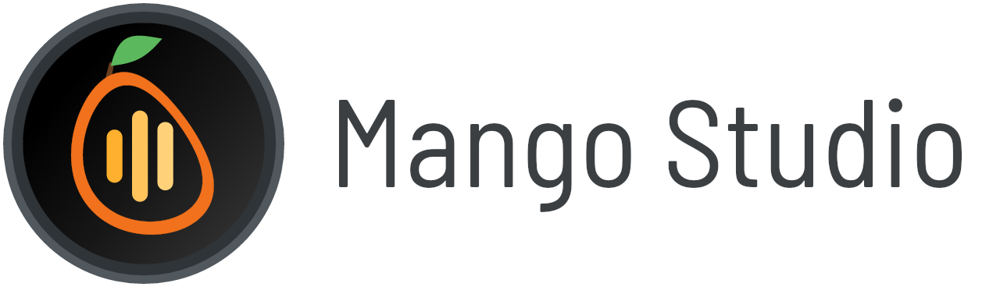
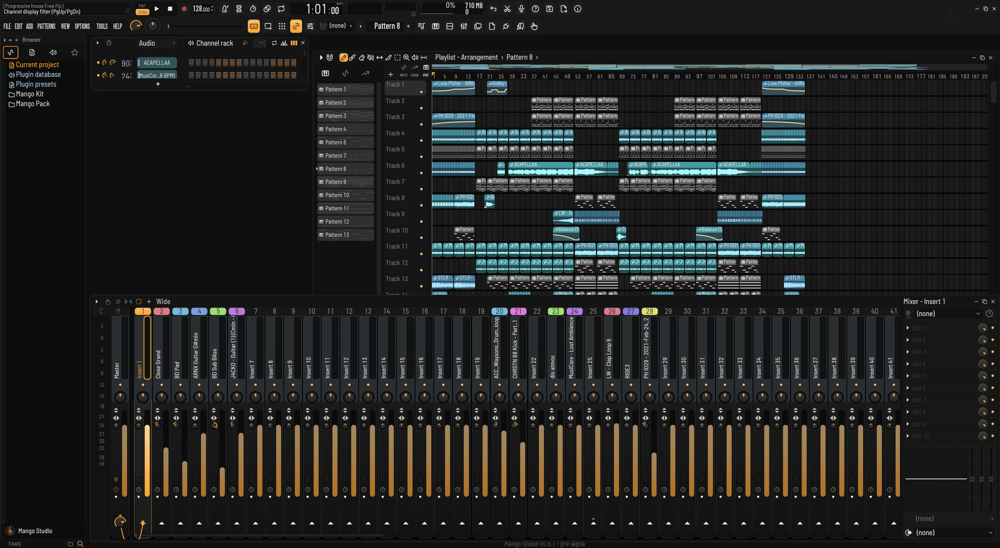
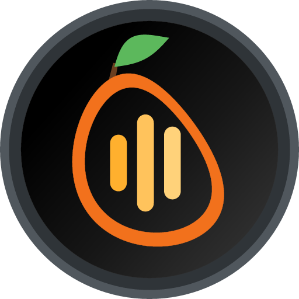

<div align="center">

<picture>
  <source media="(prefers-color-scheme: dark)" srcset="docs/assets/logo-dark.png">
  <source media="(prefers-color-scheme: light)" srcset="docs/assets/logo-light.png">
  
</picture>

<h3>A free and open-source digital audio workstation, written in Rust.</h3>

<p>
  <a href="https://github.com/apikun/Mango-Studio/actions/workflows/ci.yml"></a>
  <a href="LICENSE"></a>
  
  
  
  <a href="https://discord.gg/yC2uCuGs3M"></a>
</p>

<p>
  <a href="#credits">Credits</a> ·
  <a href="#overview">Overview</a> ·
  <a href="#capabilities">Capabilities</a> ·
  <a href="#getting-started">Getting started</a> ·
  <a href="#architecture">Architecture</a> ·
  <a href="#roadmap">Roadmap</a> ·
  <a href="#contributing">Contributing</a> ·
  <a href="#community">Community</a> ·
  <a href="#license">License</a>
</p>

<br>



</div>

---

## Credits

**Mango Studio is a fork of [Lemon Studio](https://github.com/ItsAlphaNeon/Lemon-Studio) by ItsAlphaNeon**, renamed so it
is not confused with the original. Almost all of its code, design and documentation is ItsAlphaNeon's and the Lemon
Studio contributors' work, used under the GNU GPL, version 3 or later; their copyright lines stay in every file they
wrote. Mango Studio does not claim to be Lemon Studio or to be made or endorsed by its author.

The Mango Studio name, logo and mango look are by [Artig3nce](https://github.com/Artig3nce). The Android port is by
[apikun](https://github.com/apikun). The other changes since the fork (FL-style playlist and piano roll improvements,
new effects and the releases) are by both of them, with work brought in from other forks kept under its author's name
in the commit history, such as [battlemountain2](https://github.com/battlemountain2) and
[mikobuntu](https://github.com/mikobuntu).

**The Android port's scaffolding follows [honeydew](https://github.com/daijro/honeydew) by daijro** — an independent,
clean-room FL Studio Mobile rebuilt in Rust (GPL 3.0 or later): the gradle project, the NativeActivity wiring and the
APK build flow. Credited in THIRD-PARTY-NOTICES.txt.

What Mango Studio changes from Lemon Studio:

- The name, logo and icons (a mango with an equalizer inside), and the built-in plugins' names (Mango Sampler, Mango Trio, ...).
  Projects and presets saved with the Lemon names still open: the plugins answer to their old names too.
- Its settings folder is `Mango Studio`; Lemon Studio's settings are copied there at the first start.
- An FL-style start layout (channel rack, a full-height playlist, a tall mixer along the bottom), interface scaling that
  follows the monitor's resolution, FL-style round switches and step buttons, and the playlist's playhead line.

## Overview

Mango Studio is a pattern-based music production environment: build patterns in a step sequencer and
piano roll, arrange them on a playlist, and mix them through a routable mixer. It is written from the
ground up in Rust, with a sample-accurate audio engine, a fast CPU-rendered interface and hosting for
CLAP, VST3 and VST2 plugins.

Mango Studio runs on Windows, Linux and macOS, and every change is built and tested on all three. macOS is supported
at the same level as Linux; the few differences are listed in the [macOS notes](#macos).

A central goal is **interoperability**: Mango Studio opens and saves FL Studio projects (`.flp`). The
project reader is built to round-trip: anything in a file that Mango Studio does not understand yet is
kept and written back unchanged, so a project survives being opened and saved. This support is still
young, so read the warning below before trying it on real work.

> [!WARNING]
> **Mango Studio is pre-alpha software.** It is under active development and is not yet a usable DAW:
> expect missing features, rough edges and breaking changes.
>
> - **Greyed-out controls are not implemented yet.** Many menus and buttons are already laid out but do
>   nothing so far; they are drawn dim and say "not available yet".
> - **Only projects saved by FL Studio 24.2 or later open for now** (25 and 26 included). Older projects
>   are refused with a dialog that explains how to re-save them; support for them is on the roadmap.
> - **Project-file support is at a very early stage.** Do not overwrite your original `.flp` projects
>   with files saved by Mango Studio until this support is declared stable. Work on copies and keep backups.

## Capabilities

Where Mango Studio stands against what a complete DAW offers:

| Area | Status | Notes |
|---|:---:|---|
| Step sequencing and patterns | ✅ | Channel rack with steps, mini piano rolls, swing and per-channel loops |
| Piano roll | ✅ | Full tool set, velocity and event lanes, quantize (FL's templates), chop (FL's patterns), randomize (melodies and levels), strum, arpeggiate, flam, claw machine, flip, level scaling, limit, LFO and more |
| Song arrangement | ✅ | Playlist with pattern, audio and automation clips, clip groups, markers and several arrangements |
| Mixing and routing | ✅ | Mixer tracks, sends, effect slots and meters; sidechain inputs for a project's Fruity Limiter slots and for CLAP and VST3 effects |
| Plugin hosting | ✅ | CLAP, VST3 and VST2 instruments and effects with their editors; "Create automation clip" in CLAP and VST3 plugins' own parameter menus; a parameter menu for every plugin parameter (automation clips, controller links, typed and set values); on Windows a crashing plugin is stopped instead of closing Mango Studio; on Linux, Windows plugins through [yabridge](https://github.com/robbert-vdh/yabridge) (installed from the plugin manager, marked "Windows" in the lists); no 32-bit plugins |
| Plugin management | ✅ | Plugin manager with your own search folders, a crash-safe background scan, favourites and hidden plugins; presets of your own and factory presets, import of `.vstpreset`, `.fxp` and `.fxb` files, and preset files dropped onto a plugin |
| Time-stretching | ✅ | All twelve stretch methods for samples and audio clips, played by one open-source stretcher |
| Playback engine | 🚧 | Renders ahead of the audio device so edits do not cause dropouts; voice limits, cut groups, glides, layer channels; one audio thread for now |
| Automation | 🚧 | Clips for channel, mixer and plugin parameters with every curve shape, their range and their LFO; channel volume and pan moves record into a pattern; not yet recording into automation clips |
| Project files | 🚧 | Opens and saves projects from FL Studio 24.2 and later; projects from FL 20 to 24.1 open converted (Save asks for a new file); older ones are not read yet. Keep backups |
| Built-in instruments and effects | 🚧 | Instruments: Mango Sampler (long samples can play straight from disk), Mango DirectWave (a sampler: eight zones, each one sample and where it plays), Mango Trio (three oscillators), Mango Font (SF2 bank and preset player with automatable envelope, LFO, cutoff, modulation and effect sends), Citrus (a six-operator synth that plays Sytrus patches), Mango Kick (a kick drum), Mango Boom (a bass drum), Mango Bass (a bass guitar), Mango Acid (an acid bass), Mango
Monk (a singing vocal synthesizer), Mango Pluck (a plucked string), Mango Mini (a two-oscillator synth), Mango DX (a small FM synth), Mango Autogun (a seed-grown patch synth), Mango Drums (a synthesized drum voice), Mango Surface (a control surface: eight faders a performance links, records and automates), Mango BeepMap (an image synthesizer: a loaded PNG sings), Mango Flex (a preset synthesizer with four macros), Mango Keys (an electric piano) and Mango Slayer (an electric guitar). Effects: Mango Parametric EQ (all of FL's quality modes: HQ+, HQ Enhanced, linear phase), Limiter, Reverb, Delay, Chorus, Stereo Shaper, Stereo Enhancer, Balance, Soft Clipper, Fast Distortion, Transient Processor, Filter, Flanger, Phaser, Mango Beat (FL's Gross Beat: time and gate envelopes per beat), Press (FL's Maximus) and Pulp Filter (FL's Fruity Love Philter). All built in, and also VST3 and CLAP plugins for other DAWs; a project's Fruity Limiter slots play Mango Limiter's sound, sidechain included |
| Exporting audio | ✅ | Song, pattern or selection to WAV, FLAC, MP3 and OGG at once; bit depth, sample rate, interpolation, dither, mono, tails, stems and WAV markers; a pattern rendered as an audio clip (Quick render, Render and replace) |
| MIDI file import / export | ✅ | Import into a new project, the open one or a piano roll channel (tracks, channels, tempo changes, time signatures, markers), the channels playing the Trio, Citrus, the Sampler, the chanting Monk (every part sings) or an 8-bit square patch; export a pattern or the song's patterns |
| Note input | 🚧 | Mouse, computer keyboard, MIDI controllers (velocity curves, sustain pedal, pitch bend, aftertouch) and the touch controller; note recording into patterns with loop record, precount and Start on input; step edit |
| MIDI controllers and sync | ✅ | Link any knob, fader or plugin parameter to a controller (or many at once with Multilink); MIDI clock and time code out, external clock in |
| Undo | 🚧 | One history for the whole project, with redo and the browser's History: edits, knobs and faders, channels added and deleted, project settings; not yet for a plugin editor's own changes |
| Audio drivers | 🚧 | WASAPI (shared and exclusive) and ASIO® (output, and inputs for audio recording) on Windows, ALSA (and PipeWire / PulseAudio through it) on Linux, Core Audio on macOS; no JACK yet |
| Platforms | 🚧 | Windows 10 / 11, Linux (X11, and Wayland through XWayland) and macOS 11 or newer; macOS is supported at the same level as Linux |
| Look and themes | 🚧 | Lemon and Citrus (formerly Classic) skins; 25 built-in themes, your own themes and `.flstheme` files colour either skin, with live adjustments and a colour picker; Lemon plugin editors in the Lemon design only |
| Settings | 🚧 | The General, Audio, MIDI, File, Theme, Project, Info and Recording pages work; a few controls stay greyed out until their features are built |
| Audio recording | 🚧 | One-click audio recording into the playlist or the audio editor, from ASIO or system inputs; Tesla records what reaches its mixer slot |
| Audio editing | ✅ | Tesla, the audio editor and recorder after FL's Edison: a mixer effect (and VST3 / CLAP plugin) with markers, regions, destructive edits and tools; a project's Edison slots open in it |
| Plugin delay compensation | 🚧 | Plugins' reported delays and the mixer tracks' latency settings, in playback and exports; the settings can't be edited yet |

✅ usable · 🚧 partial · ❌ not available yet


ASIO is a registered trademark of Steinberg Media Technologies GmbH.

<table>
  <tr>
    <td width="50%"><a href="docs/assets/screenshot-piano-roll.webp"></a></td>
    <td width="50%"><a href="docs/assets/screenshot-playlist.webp"></a></td>
  </tr>
  <tr>
    <td align="center"><sub>Piano roll: chords and a melody with their note names, and the velocity lane below</sub></td>
    <td align="center"><sub>Song arrangement: pattern, audio and automation clips under section markers</sub></td>
  </tr>
</table>

Per-area details are in [docs/status.md](docs/status.md). The full, item-by-item roadmap is in the
[Roadmap](#roadmap) section below, and kept on the original Lemon Studio's [Discord server](https://discord.gg/yC2uCuGs3M).

## Getting started

Ready-to-run builds are attached to this repository's GitHub releases for **Windows and Linux (x64)** and **Android
(arm64)**: portable binaries, with no installer and no runtime to install. macOS has no prebuilt binary yet — there
Mango Studio is built from source for now. Each platform below goes from a fresh machine to Mango Studio installed with its
icon, and Mango Studio's own plugins installed for any DAW. Building from source works on all three and needs
**Rust**, stable toolchain 1.89 or newer, installed through [rustup](https://rustup.rs/), and a clone of this
repository:

```bash
git clone https://github.com/apikun/Mango-Studio.git
cd Mango-Studio
```

`cargo run -p os-app --release` builds and runs Mango Studio. Before Mango Studio starts, it also rebuilds Mango
Studio's own plugins (Mango Sampler, Mango Trio, Mango Parametric EQ, Mango Limiter, Mango Reverb, Mango Delay, Mango
Soft Clipper, Mango Fast Distortion, Mango Balance, Mango Stereo Enhancer, Mango Transient Processor, Mango Chorus,
Mango Stereo Shaper, Mango Filter, Mango Flanger, Mango Phaser, Mango Beat, Citrus, Tesla, Press, Pulp Filter, Mango Kick, Mango Boom, Mango Bass, Mango Acid and Mango Monk) and
installs the ones that changed as VST3 and CLAP plugins, in the folders where other DAWs find them. Mango Studio itself
has every one of them built in and needs no plugin files. A plugin that is new or updated in the repository shows up
in other DAWs at the next run. The first run builds every plugin, which takes
a few minutes more; later runs rebuild only what changed. Set `OPENSTUDIO_NO_PLUGIN_BUILD=1` to skip the plugin build. A
Mango Studio installed as below builds nothing: after pulling changes, either run the command above once, or build and
install only the plugins with `cargo run -p bundle-plugins -- --install`.

### Windows

Windows 10 or 11, x64. A ready-to-run build is attached to this repository's GitHub releases: `Mango-Studio-windows-x64.zip`,
a portable `mangostudio.exe` with no installer and no runtime to install. To build the newest state of the source
instead, follow the steps below.

**Prerequisites**

- The Microsoft C++ build tools that Rust uses (rustup offers them when it installs; otherwise the Visual Studio Build
  Tools with the "Desktop development with C++" workload). They include the Windows SDK, which embeds the application
  icon in the program; without the SDK the build still succeeds, without the icon.
- LLVM, whose libclang generates the time stretcher's and the ASIO SDK's bindings at build time:
  `winget install LLVM.LLVM`. If `libclang.dll` is not in LLVM's default folder, set `LIBCLANG_PATH` to the folder
  that holds it.

**Build and run**

```powershell
cargo run -p os-app --release
```

**Install** `lemonstudio.exe`, with its icon, into `%USERPROFILE%\.cargo\bin`, and give it a Start menu entry (from there
it can be pinned to the taskbar):

```powershell
cargo install --path crates/os-app
$link = (New-Object -ComObject WScript.Shell).CreateShortcut("$env:APPDATA\Microsoft\Windows\Start Menu\Programs\Mango Studio.lnk")
$link.TargetPath = "$env:USERPROFILE\.cargo\bin\lemonstudio.exe"
$link.Save()
```

**Plugins:** `cargo run -p os-app --release` installs Mango Studio's plugins in `%LOCALAPPDATA%\Programs\Common\VST3`
and `...\CLAP`, where DAWs find them. To build and install them without starting Mango Studio, run
`cargo run -p bundle-plugins -- --install`.

**Notes**

- A plugin that crashes is stopped (its slot passes the sound through) instead of closing Mango Studio.
- Settings, themes and presets live in `%APPDATA%\Mango Studio`. `OPENSTUDIO_USER_DIR` overrides the folder.
- Plugins are found in `%LOCALAPPDATA%\Programs\Common\{VST3,CLAP}`, `%COMMONPROGRAMFILES%\{VST3,CLAP}` and
  `CLAP_PATH`, plus any folder added in Settings > Plugins. VST2 plugins are found in the folder their installers
  record (`HKEY_LOCAL_MACHINE\SOFTWARE\VST`, `VSTPluginsPath`) and in those of `%PROGRAMFILES%\VSTPlugins`,
  `%PROGRAMFILES%\Steinberg\VSTPlugins`, `%COMMONPROGRAMFILES%\VST2` and `%COMMONPROGRAMFILES%\Steinberg\VST2` that
  exist. 32-bit VST2 plugins cannot be loaded: they are listed as not supported, without being tried.

#### Winlator (Android)

The release build runs on Winlator, which runs Windows programs on Android through Wine and Box64. The interface is
drawn by the CPU (no GPU is used), so it runs in any container on any GPU driver, and the CPU panel's FPS reading
shows how fast it paints.

**Setup**

- Container: Wine 9.x or newer, the Box64 preset "Performance" (if the program will not start, try "Compatibility"),
  four CPU cores or more.
- Audio: the container's PulseAudio driver is the sound card. In Settings > Audio leave shared mode on; if playback
  pops, set Buffer length to 1024.
- Exclusive (WASAPI) mode, ASIO drivers and IAudioClient3's short buffers are not implemented by Wine: the program
  falls back to shared mode on its own and says so above the status lines.
- Small screens: the top band scales down to fit (auto fit, 2026-10-27), so every panel — the output monitor's
  waveform display among them — stays visible on a phone's narrow window. A Toolbars scaling percentage chosen by
  hand is kept as it is.

**If it will not start**, or a plugin crashes it, `%APPDATA%\Mango Studio\panic-log.txt` (in the container:
`C:\users\<user>\AppData\Roaming\Mango Studio\panic-log.txt`) holds the last panic's message, and a failure at
startup shows a message box instead of closing quietly.

**If the keyboard and playback make no sound** while the metronome and the Tempo tapper do: a new project's channel
is a sampler with no sample, and a sampler without a sample is silent — the hint bar says so when a note plays on it.
Drop a sample from the browser onto the channel, or add an instrument with the channel rack's plus (Mango Trio,
Mango Kick, Mango Bass, Mango Acid, Mango Monk ... all built in). If the hint bar says a plugin did not follow the audio rate,
or nothing helps, set `OS_DEBUG=1` in the container's environment and run once more: the log names the plugin and
the rates it was asked for.

### Android

Mango Studio Mobile, Android 8.0 (API 26) or newer, arm64 phones and tablets. A ready-to-run build is attached to this
repository's GitHub releases: `Mango-Studio-android-arm64.apk`. Install it (Android asks to allow installs from the
browser or file manager once) and open Mango Studio from the launcher. It is the whole desktop app — the device rack,
the playlist, the mixer and every built-in plugin, Mango Beat included — with touch in place of the mouse:

- One finger is the mouse: it moves the pointer and presses the left button, so notes draw, drags drag and the browser scrolls.
- A finger held still for about half a second is a right click: the menus are right-click menus, and that is how they open.
- Multi-finger gestures (pinch to zoom, two-finger scroll) and the on-screen keyboard are planned next; a hardware or
  Bluetooth keyboard works today, and so does the Touch controller (VIEW > Touch controller) with it.

The audio device is the Android one (AAudio, shared): Settings > Audio lists it, at the device's own rate and buffer.
Projects, settings, themes and presets live in the app's private folder, which Android keeps to the app itself; a
document picker for opening files from shared storage is on the roadmap, next to the on-screen keyboard.

**Build it from source** with the Android SDK and NDK r28b installed (`ANDROID_HOME` set, `cargo` and Java 17+ on the
path) and the `aarch64-linux-android` rustup target:

```bash
rustup target add aarch64-linux-android
tools/android-dist.sh          # writes Mango-Studio-android-arm64.apk
tools/android-dist.sh --debug  # the debug-name build for a side-by-side install
```

### Linux

x64, on X11 or a Wayland desktop. A ready-to-run build is attached to this repository's GitHub releases:
`Mango-Studio-linux-x64.zip`, a portable `mangostudio` binary (in its `dist` folder, next to this README and the
third-party notices), with no installer and no runtime to install. To build the newest state of the source instead,
follow the steps below.

**Prerequisites:** a C++ compiler and libclang (for the time stretcher), the ALSA development files, the Wayland
development files (which Mango Sampler's file dialogs link against when it is built as a plugin) and `pkg-config`:

```bash
# Debian / Ubuntu
sudo apt install g++ libclang-dev libasound2-dev libwayland-dev pkg-config
# Arch
sudo pacman -S gcc clang alsa-lib wayland pkgconf
# Fedora
sudo dnf install gcc-c++ clang-devel alsa-lib-devel wayland-devel pkgconf-pkg-config
```

For the "save changes?" prompt, `zenity` or KDE's `kdialog` (a stock KDE desktop has the latter).

**Build and run**

```bash
cargo run -p os-app --release
```

**Install** `lemonstudio` into `~/.cargo/bin` (which must be on your `PATH`), with its icon and an entry in the
application menu (the desktop entry also names the icon under native Wayland):

```bash
cargo install --path crates/os-app
install -Dm644 crates/os-app/assets/lemonstudio.png ~/.local/share/icons/hicolor/256x256/apps/lemonstudio.png
install -Dm644 crates/os-app/assets/lemonstudio.desktop ~/.local/share/applications/lemonstudio.desktop
```

**Plugins:** `cargo run -p os-app --release` installs Mango Studio's plugins in `~/.vst3` and `~/.clap`. To build and
install them without starting Mango Studio, run `cargo run -p bundle-plugins -- --install`.

**Notes**

Mango Studio runs on X11, and on Wayland desktops through XWayland. Plugin editors on Linux are X11 windows, and an X11
window cannot sit inside a native Wayland one; with the main window on X11 too, plugin windows dock inside it as on
Windows (or detach, from their window menu). A few things differ from Windows for now:

- **Native Wayland** is used only when there is no X server, or when `OPENSTUDIO_WAYLAND=1` is set. Plugin windows are
  then always separate windows, kept above Mango Studio while it is the active application; their window menu, Presets
  list and Misc lists do not open, and files cannot be dropped in from a file manager (the windowing library does not
  support it there).
- **Scaling:** the main window follows [winit's X11 scale selection](https://docs.rs/winit/0.30.13/winit/window/struct.Window.html#method.scale_factor).
  Docked plugin frames and editors share that scale and follow changes; Mango plugins keep their active page when
  their editor reopens at the new scale. With a native Wayland main window, separate X11 plugin frames still use the
  X server's scale rather than the Wayland window's.
- **Hyprland with docked plugins:** keep XWayland available and leave `OPENSTUDIO_WAYLAND` unset. No compositor rules
  are required by this scaling fix. For an optional app-only size override, launch with
  `WINIT_X11_SCALE_FACTOR=1.25 mangostudio`. This does not change Hyprland's monitor scaling or guarantee that compositor
  upscaling will be sharp; the app's X11 scale and the compositor's output scale are separate settings.
- **Keys** pressed while a plugin's editor has the keyboard focus do not play the typing keyboard yet, and a sample
  dragged from Mango Studio's browser onto a plugin window does not reach the plugin yet.
- **Mango Sampler** cannot copy or paste audio through the clipboard yet.
- **Settings, themes and presets** live in `$XDG_CONFIG_HOME/Mango Studio` (usually `~/.config/Mango Studio`).
  `OPENSTUDIO_USER_DIR` overrides the folder.
- Plugins are found in `~/.clap`, `/usr/lib/clap`, `/usr/local/lib/clap` and `CLAP_PATH`, in `~/.vst3`,
  `/usr/lib/vst3` and `/usr/local/lib/vst3`, and in `VST_PATH` (else `~/.vst`, `/usr/lib/vst`, `/usr/local/lib/vst` and
  the `lxvst` folders that exist) for VST2, plus any folder added in Settings > Plugins.

### macOS

macOS 11 or newer. macOS is supported at the same level as Linux, with the same features, and
continuous integration builds and tests every change on macOS alongside Windows and Linux. No prebuilt macOS binary
is attached to the releases yet: on macOS, Mango Studio is built from source.

**Prerequisites:** the Xcode Command Line Tools, which bring the compiler and libclang: `xcode-select --install`. Xcode
itself is not needed (only to regenerate the app icon, see `tools/logo/macos-icon.sh`).

**Build and run**

```bash
cargo run -p os-app --release
```

**Install** Mango Studio as an app, `Mango Studio.app` in `~/Applications`, with its icon: it opens from Launchpad,
Spotlight or the Dock (on macOS 26 and later its icon follows the light, dark, tinted and clear icon styles), and the
Finder opens `.flp` projects with it. Without `--install` the app is only written to `target/bundled/`.

```bash
cargo run -p bundle-app -- --install
```

**Plugins:** `cargo run -p os-app --release` installs Mango Studio's plugins as bundles, signed ad hoc so that Apple
silicon loads them, in `~/Library/Audio/Plug-Ins/VST3` and `.../CLAP`. To build and install them without starting Mango
Studio, run `cargo run -p bundle-plugins -- --install`.

**Notes**

Plugin windows dock inside the main window as on Windows, or detach (from their window menu) into windows of their own
that stay above Mango Studio while it is the active application. A few things differ from Windows and Linux:

- **Menu bar:** the window's menus (FILE … HELP) are also in the macOS menu bar, with the same entries.
- **Keys:** Command stands in for Ctrl in every shortcut (Command+S saves), and
  Control+click is a right click. Quit (Command+Q, the menu bar, the Dock) asks about unsaved changes like closing the
  window does.
- **Plugin windows:** a minimized detached window is hidden rather than sent to the Dock; its channel's button brings
  it back. A sample dragged from Mango Studio's browser onto a plugin window reaches Mango Sampler only (other plugins
  take dropped files only from the Finder).
- **Microphone:** the first time a mixer track monitors or records an input (the Mac's microphone, an audio
  interface's inputs), macOS asks whether Mango Studio may use the microphone; System Settings > Privacy & Security >
  Microphone changes the answer. Started from a terminal, macOS asks on the terminal's behalf instead.
- **FL Studio's factory content** (samples that projects name through `%FLStudioFactoryData%`) is found in the newest
  `/Applications/FL Studio *.app`; `OPENSTUDIO_FACTORY` overrides it.
- **Settings, themes and presets** live in `~/Library/Application Support/Mango Studio`. `OPENSTUDIO_USER_DIR`
  overrides the folder.
- Plugins are found in `~/Library/Audio/Plug-Ins/{CLAP,VST3,VST}`, `/Library/Audio/Plug-Ins/{CLAP,VST3,VST}` and
  `CLAP_PATH`, plus any folder added in Settings > Plugins. Audio Units are not supported. On Apple silicon, plugins
  built for Intel Macs only (common among older VST2 plugins) cannot be loaded; VST2 ones are listed as not supported,
  without being tried.

### Using Mango Studio

Open a project directly by passing its path:

```bash
cargo run -p os-app --release -- path/to/project.flp
```

Use `FILE > Export audio` (Ctrl+R) to render the song, or the current pattern in PAT mode, to WAV, FLAC, MP3 or OGG files. The same
render runs without a window, hosting the same plugins the app would and without opening an audio device:

```bash
cargo run -p os-app --release -- --render path/to/project.flp out.wav [--rate 48000] [--seconds 30] [--from TICK] [--builtin-only]
```

`--builtin-only` hosts only Mango Studio's own plugins, for a render that is the same on every machine.
Settings > Theme picks the skin (Lemon, or Citrus, the look formerly called Classic) and the theme; the choice is
remembered.

Mango Trio and Mango Parametric EQ were called Mango 3x Osc and Mango Parametric EQ 2 before, and earlier all three
plugins were called Open Sampler, Open 3x Osc and Open Parametric EQ 2. They keep their plugin IDs, so sessions saved
with the old names still open with the new plugins. Installing the plugins (by the run from source or
`bundle-plugins --install`) removes bundles installed under the old names; delete any others you copied yourself, or
DAWs will list each plugin twice.

### Tests

```bash
cargo test --workspace
```

Tests that need an audio device are marked `#[ignore]` and run with `cargo test -p os-app -- --ignored`.
Project-file corpus tests run when `OPENSTUDIO_FLP_CORPUS` points to a text file listing `.flp` paths;
project files are never committed to this repository.
On a Linux desktop with X11/XWayland available, run the real docked-editor scaling check separately:

```bash
cargo test -p os-app --locked docked_editor_follows_xwayland_parent_scale -- --ignored --nocapture
```

It embeds Mango Sampler under an unmapped X11 parent (without taking desktop focus), checks the editor and its frame
at 100%, 125%, 150% and 200%, verifies docking and active-page preservation, and checks that a docking request
reconciles a stale editor scale. It is explicitly ignored in the
ordinary suite because it requires a display; it does not certify every third-party editor or mixed-DPI monitor setup.

The watermark test (`cargo test -p watermark`) checks that every source file opens with its header: a copyright line
for each of its copyright holders, its SPDX licence identifier and the project's name.

### Command-line tools

| Tool | Purpose |
|---|---|
| `flp-dump` | Print a project file's event stream and verify that it round-trips |
| `os-render` | Render a project or pattern offline to a WAV file with the engine alone (no hosted plugins, so it does not sound like the app; `--render` above does) |
| `os-play` | Play a project through the default audio output |
| `bundle-plugins` | Build Mango Studio's own plugins as VST3 and CLAP bundles, and optionally install them (`cargo run -p os-app --release` runs it with `--install`) |
| `bundle-app` | Build Mango Studio as a macOS app, and optionally install it |

## Architecture

Mango Studio is a Cargo workspace of focused crates:

| Crate | Responsibility |
|---|---|
| [`os-model`](crates/os-model) | Project data model, free of I/O |
| [`os-flp`](crates/os-flp) | Lossless `.flp` event-stream reader/writer and model mapping |
| [`os-engine`](crates/os-engine) | Audio engine: sampler, mixer, routing, effects, envelopes, automation |
| [`os-dsp`](crates/os-dsp) | DSP building blocks: level curve, pan split, gain glides, mixer matrix and equaliser |
| [`os-theme`](crates/os-theme) | Colour palette, skins (Lemon, Citrus), theme files and the HSL adjustment model |
| [`os-ui`](crates/os-ui) | CPU canvas, text rendering and the shared widget kit |
| [`os-app`](crates/os-app) | The `lemonstudio` application: windows, editors, transport |
| [`os-host`](crates/os-host) | Format-neutral plugin hosting layer (CLAP, VST3, VST2) |
| [`os-clap`](crates/os-clap) | CLAP plugin host |
| [`os-vst3`](crates/os-vst3) | VST3 plugin host |
| [`os-vst2`](crates/os-vst2) | VST2 plugin host, on a clean-room description of the interface (no Steinberg SDK) |
| [`os-hostlink`](crates/os-hostlink) | Host link protocol between Mango Studio and its own plugins |
| [`os-plugkit`](crates/os-plugkit) | Shared editor pieces of Mango Studio's own plugins |
| [`os-paths`](crates/os-paths) | Where Mango Studio keeps its settings, themes and presets on each platform |
| [`lemon-sampler`](plugins/lemon-sampler) | Mango Sampler instrument (VST3 + CLAP) |
| [`lemon-3x-osc`](plugins/lemon-3x-osc) | Mango Trio instrument (VST3 + CLAP) |
| [`lemon-parametric-eq-2`](plugins/lemon-parametric-eq-2) | Mango Parametric EQ effect (VST3 + CLAP) |
| [`lemon-limiter`](plugins/lemon-limiter) | Mango Limiter effect (VST3 + CLAP) |
| [`lemon-reverb`](plugins/lemon-reverb) | Mango Reverb effect (VST3 + CLAP) |
| [`lemon-delay`](plugins/lemon-delay) | Mango Delay effect (VST3 + CLAP) |
| [`lemon-small-fx`](plugins/lemon-small-fx) | What the small Mango effects share: the plugin, its state, the editor and each effect's description |
| [`lemon-soft-clipper`](plugins/lemon-soft-clipper) | Mango Soft Clipper effect (VST3 + CLAP) |
| [`lemon-fast-distortion`](plugins/lemon-fast-distortion) | Mango Fast Distortion effect (VST3 + CLAP) |
| [`lemon-balance`](plugins/lemon-balance) | Mango Balance effect (VST3 + CLAP) |
| [`lemon-stereo-enhancer`](plugins/lemon-stereo-enhancer) | Mango Stereo Enhancer effect (VST3 + CLAP) |
| [`lemon-transient-processor`](plugins/lemon-transient-processor) | Mango Transient Processor effect (VST3 + CLAP) |
| [`lemon-chorus`](plugins/lemon-chorus) | Mango Chorus effect (VST3 + CLAP) |
| [`lemon-stereo-shaper`](plugins/lemon-stereo-shaper) | Mango Stereo Shaper effect (VST3 + CLAP) |
| [`lemon-filter`](plugins/lemon-filter) | Mango Filter effect (VST3 + CLAP) |
| [`lemon-flanger`](plugins/lemon-flanger) | Mango Flanger effect (VST3 + CLAP) |
| [`lemon-phaser`](plugins/lemon-phaser) | Mango Phaser effect (VST3 + CLAP) |
| [`mango-beat`](plugins/mango-beat) | Mango Beat effect, a Gross Beat-style time manipulator (VST3 + CLAP) |
| [`citrus`](plugins/citrus) | Citrus instrument, a six-operator synthesizer (VST3 + CLAP) |
| [`tesla`](plugins/tesla) | Tesla, the audio editor and recorder (VST3 + CLAP) |
| [`press`](plugins/press) | Press effect, a multiband maximiser (VST3 + CLAP) |
| [`pulp-filter`](plugins/pulp-filter) | Pulp Filter effect, a pattern-controlled multi-filter (VST3 + CLAP) |
| [`lemon-small-gen`](plugins/lemon-small-gen) | What the small Mango generators share: the plugin, its state, the editor and each instrument's description |
| [`lemon-kick`](plugins/lemon-kick) | Mango Kick, a kick drum (VST3 + CLAP) |
| [`lemon-boom`](plugins/lemon-boom) | Mango Boom, a bass drum (VST3 + CLAP) |
| [`lemon-bass`](plugins/lemon-bass) | Mango Bass, a bass guitar (VST3 + CLAP) |
| [`lemon-acid`](plugins/lemon-acid) | Mango Acid, an acid bass (VST3 + CLAP) |
| [`mango-monk`](plugins/mango-monk) | Mango Monk, a singing vocal synthesizer (VST3 + CLAP) |
| [`mango-surface`](plugins/mango-surface) | Mango Surface, a control surface: eight faders a performance links, records and automates; it sounds nothing (VST3 + CLAP) |
| [`mango-dashboard`](plugins/mango-dashboard) | Mango Dashboard, a hardware panel: twelve knobs and four faders a performance links, records and automates; it sounds nothing (VST3 + CLAP) |
| [`mango-beepmap`](plugins/mango-beepmap) | Mango BeepMap, an image synthesizer: a loaded PNG sings, its columns the time, its rows the pitch (VST3 + CLAP) |
| [`mango-flex`](plugins/mango-flex) | Mango Flex, a preset synthesizer: two hundred fifty-six named presets and four macros over each, the echo and space of the preset behind them (VST3 + CLAP) |
| [`mango-directwave`](plugins/mango-directwave) | Mango DirectWave, a sampler: a program of eight zones, each one sample and where it plays — key and velocity ranges, gain, pan, tune and loop — through the master's envelope and filter (VST3 + CLAP) |
| [`lemon-pluck`](plugins/lemon-pluck) | Mango Pluck, a plucked string (VST3 + CLAP) |
| [`lemon-mini`](plugins/lemon-mini) | Mango Mini, a small subtractive synthesizer (VST3 + CLAP) |
| [`lemon-dx`](plugins/lemon-dx) | Mango DX, a small FM synthesizer (VST3 + CLAP) |
| [`lemon-autogun`](plugins/lemon-autogun) | Mango Autogun, a seed-grown patch synthesizer (VST3 + CLAP) |
| [`lemon-drums`](plugins/lemon-drums) | Mango Drums, a synthesized drum voice (VST3 + CLAP) |
| [`lemon-keys`](plugins/lemon-keys) | Mango Keys, an electric piano (VST3 + CLAP) |
| [`mango-slayer`](plugins/mango-slayer) | Mango Slayer, an electric guitar: six Karplus-Strong strings a pickup reads, an amp behind them (VST3 + CLAP) |
| [`mango-soundfont`](plugins/mango-soundfont) | Mango Font, an SF2 bank and preset player with automatable envelope, LFO, cutoff, modulation and effect sends (VST3 + CLAP; built into the app) |

## Roadmap

The item-by-item roadmap, as it is kept on the [Lemon Studio Discord server](https://discord.gg/yC2uCuGs3M) (the original project's):
every feature marked as done, in progress or not started.

✅ done · 🚧 in progress · ⬜ not started

### Audio engine

- ✅ Sample-accurate pattern and song playback
- ✅ Sampler with high-quality windowed-sinc resampling
- ✅ Mixer graph: sends, sidechain routing, measured pan and volume laws
- ✅ Sidechain inputs for mixer slot effects and hosted CLAP / VST3 effects
- ✅ Channel envelopes, note repeat and per-pattern control lanes
- ✅ Automation clips for channel, mixer and plugin parameters
- ✅ Channel note rules: max polyphony, mono, portamento glides, cut groups
- ✅ Glides on every instrument: Mango Trio and Citrus follow portamento and slides, other plugins get pitch bend
- ✅ Live edits reach playback instantly, without clicks
- ✅ Offline rendering (`os-render`) and low-latency WASAPI output
- ✅ Render a project without opening a window (`lemonstudio --render`)
- ✅ Built-in limiter
- ✅ Main swing in playback (measured timing)
- ✅ Tick clock: whole-tick scheduling and swing, exact song length and render tail
- ✅ Song rules: uncut clips play the whole pattern, one play position per pattern, "play truncated notes"
- ✅ Mixer tracks: stereo separation, three-band track equaliser, gliding gains
- ✅ Mixer track polarity, stereo swap and effect bypass played
- ✅ Main volume and main pitch knobs work; channel pitch follows root note, fine tune and main pitch
- ✅ Time stretching: every stretch method of sampler channels and audio clips (Signalsmith Stretch)
- ✅ Tempo automation playback
- ✅ Playback started inside an audio clip plays it from there, with a short fade-in
- ✅ Export the song or pattern as WAV, FLAC, MP3 or OGG from the Export form, with every hosted plugin
- ✅ Playback under load: rendered ahead of the audio device, so heavy passages and edits no longer drop out (about 4x less audio load)
- ✅ No more stutter from plugins the interface is busy with
- ✅ Audio settings: output device, sample rate and buffer length, applied while playing
- ✅ Stop ends every voice, plugins included
- ✅ Playback accuracy: audio clips at full level, automation on the exact tick with all 13 curve shapes, MP3 timing, slide notes
- ✅ Automation clips drive every target they are linked to; mixer automation of slots, EQ bands, sends and stereo separation
- ✅ Layer channels, channel level adjustments, and each note's own pan and mod X / Y
- ✅ Plugin delay compensation, live and in exports, with the mixer tracks' latency settings
- ✅ Parametric EQ quality modes: HQ+, HQ Enhanced and linear phase, with their delay reported
- 🚧 Engine rework from the engine specifications: sampler voice, automation
- ✅ Fruity Limiter slots in FL projects play the whole limiter: compressor, gate and sidechain
- ✅ ASIO audio output, plus WASAPI exclusive mode on Windows

### Interface

- ✅ Playlist: clips, markers, automation, nine editing tools, undo
- ✅ Piano roll: full tool set, velocity panel, live note preview
- ✅ Piano-roll shortcuts and Tools menu: quick quantize, legato, chop, glue, strum, arpeggiate, randomize, ghost channels, time markers
- ✅ Piano-roll keyboard shortcuts match FL
- ✅ Piano roll: FL's tool dialogs: Quantize, Chop, Randomize, Strum, Arpeggiate, Flam, Flip, Scale levels, Limit, Claw machine and LFO
- ✅ Piano-roll vertical zoom
- ✅ Channel rack: step sequencer, mini piano rolls, graph editor, filter groups, per-channel loops, fill tools, swing, clone / move / delete channels
- ✅ Mixer: routing, effect slots, track editing, level meters with peak hold
- ✅ Browser with drag and drop, sample preview, the built-in Mango Kit and Mango Pack sample folders (the Kit's sounds made from maths, the Pack's one-shots CC0 from Versilian Studios' Virtuosity Drums)
- ✅ Menus, plugin picker, settings window
- ✅ Floating, resizable windows; scroll bars in every window; plugin windows dock or detach
- ✅ Right-drag a scroll bar sideways to resize rows (playlist tracks, piano-roll keys)
- ✅ Theme engine with `.flstheme` import
- ✅ Skins and themes: 25 built-in themes that colour both skins, live adjustments with a colour picker, your own themes
- ✅ Computer-keyboard note input
- ✅ MIDI controller input (notes play the selected channel)
- ✅ MIDI devices: Settings > MIDI, controller links, MIDI clock out and in
- ✅ Recording: notes and knob moves into patterns, loop record, record options, one-click audio recording
- ✅ Audio editor entries open Tesla: record into it from a mixer track or one-click recording
- ✅ Project picker and touch controller (pads and keys) on the toolbar
- ✅ Controls that are not available yet are greyed out everywhere
- ✅ Asks before unsaved changes are lost; Ctrl+N saves a new version
- ✅ Recent projects in the FILE menu
- ✅ FILE menu: revert to last backup, templates, save to a new project folder, delete unused files
- ✅ Undo covers every edit: mixer faders, added, inserted, replaced and deleted channels, project settings and info, plugin parameters, timebase
- ✅ High-DPI: follows the Windows display scale, plugin editors included
- ✅ Large projects load behind a progress panel (no more freezes)
- ✅ Snappier UI: repaints only what changes, cached drawing, steady 60 fps
- ✅ Faster scrolling: move the drawn picture instead of repainting the window
- ✅ Lemon design: new default look (lemon on neutral greys, rounded-square controls); Classic look kept as a skin
- ✅ Playhead and meters keep moving while a plugin menu or dialog is open
- ✅ Lemon design for the built-in plugin editors
- ✅ CPU panel (audio load, voices, memory, dropouts), polyphony counter and plugin performance monitor
- ✅ Metronome, tempo tapper, song position slider, auto scrolling and enable groups
- ✅ Close all windows (F12), select unused channels, purge unused audio clips
- ✅ Piano roll: snap menu, target channel menu, resizable event panel
- ✅ Global snap panel on the toolbar
- ✅ Type in value: type an exact value into knobs, faders and plugin parameters
- ✅ Mixer track commands: route to a free track, channel routing, select, alt solo, trim unused tracks
- ✅ Mixer track equaliser is editable: drag its bands on the graph, or use the knobs and faders
- ✅ Menu bar and toolbar: dropdown submenus, PATTERNS commands (split by channel, set time signature, open in the browser), ADD audio and automation clip channels, toolbar right-clicks, SMPTE time display
- ✅ Pattern time signatures: the channel rack and piano-roll grid follow them
- ✅ Settings: the OPTIONS pages work — General, Audio, MIDI, File, Theme, Project, Info and Recording — with one project-wide undo history, Auto close, Step edit and project data folders
- ✅ Channel menu and plugin window menu: Replace puts another generator on the channel
- 🚧 Hover and pressed states across all widgets
- ⬜ Channel rack: loop starter, advanced looping, Patcherize
- ✅ Window positions remembered between sessions
- ✅ Modular toolbar: an editor for its panels, with factory and user presets
- 🚧 Own UI scale setting (GUI and toolbar scaling work), one-row toolbar on wide screens
- ✅ Hover tooltips: the widget kit's bubble shows a control's hint at the cursor
- ✅ Theme files: workspace picture and grid line strength
- ⬜ Theme extras: note colour groups
- 🚧 MCP Server for autonomous AI agents to connect and control (groundwork in review)

### Playlist and browser extras

- ✅ Clicking the ruler to seek
- ✅ Stretch modes (Shift+M)
- ✅ Arrangement switching and track groups
- ✅ Refreshed playlist look: channel-coloured clips, smooth waveforms, group headers, flag and marker tabs
- ✅ Audio clip fades and clip gain, edited with handles on the clip
- ✅ Audio clips follow their channel's stretch, pitch and tempo (length and waveform update)
- ✅ Double-click a clip: audio clips open their sampler, pattern clips the piano roll
- ✅ Quick quantize and export of every playlist track
- ✅ Playlist track height (vertical zoom)
- ✅ Clip groups: group, ungroup, select, move and copy together
- ✅ More playlist shortcuts: zoom on selection, quick slice, snap cycling, insert a bar
- ✅ Browser: drop effects into mixer slots
- ✅ Instruments load straight onto the arranger: a generator dropped on the playlist or a track header, or the header menu's Insert instrument ▸, makes the channel and places a clip of a new pattern named after it on that track (issue #2)
- ✅ Browser: the drop zone shows on the playlist while a sample, pattern or audio/automation channel is dragged over it — a translucent clip at the snapped start, named like the clip will be (issue #4)
- ✅ Browser: reread (Ctrl+R) and only rows that have content
- ✅ Browser: drag its width, long names scroll on hover, a right-click menu on every row
- ✅ Browser: the arrow keys walk the tree as FL's do — a sample is heard the moment it is focused, Right replays it from the start, Left and Right open and close the folders
- ✅ New patterns can be placed right away, shortened pattern clips cut, Ctrl+Space pauses, the piano roll works in song mode
- ✅ Automatic crossfades between audio clips, with their own handle
- ✅ Time markers: start, loop, marker loop / skip / pause, played in song mode and in exports
- ✅ PATTERNS: render a pattern as an audio clip, or render and replace it
- ⬜ Browser: tags, favourites

### Plugins

- ✅ CLAP and VST3 hosting: instruments, mixer effects, editors inside the plugin window
- ✅ VST2 hosting, including the VST2 plugins of FL projects (new: keep backups)
- ✅ Plugin menus and plugin manager: your own search folders, crash-safe background scan, favourites, hidden plugins, one entry per plugin across formats
- ✅ Plugin parameters and automation: browse parameters, "Create automation clip" from plugin menus
- ✅ Plugins get the song tempo and position
- ✅ Plugin channels follow their root note and the main pitch
- ✅ Presets for every plugin: list, step and save from the plugin window
- ✅ Plugin presets: factory presets, import (`.vstpreset`, `.fxp` / `.fxb`), drag and drop onto a window, rack row or mixer slot
- ✅ VST3 plugins' own context menus; parameter menu with Set... and Edit automation clip...
- ✅ Plugin window Misc tab: levels, polyphony, time, tracking, cut groups, arpeggio, echo, root note
- ✅ Mango Sampler plays every sampler channel and audio clip, including factory-library samples
- ✅ Mango Sampler plays a project's sample settings, channel filter and note levels
- ✅ Host link protocol for Mango Studio's own plugins
- ✅ Crash protection: a plugin that crashes is stopped (its slot passes the sound through) instead of closing the app (Windows)
- 🚧 Experimental native plugin host (opt-in: effects in mixer slots, editors in the plugin window)
- ✅ Mango Sampler: loop points, time stretch, LFOs
- ✅ Mango Sampler: disk streaming (Keep on disk)
- ✅ Every Mango plugin built into the app: no plugin files needed
- 🚧 More built-in instruments and effects

### Clean-room plugins

#### Effects

- ✅ Parametric EQ 2 (Mango Parametric EQ: built into mixer slots, also VST3 and CLAP)
- ✅ Fruity Limiter (Mango Limiter: built into the app and mixer slots, also VST3 and CLAP)
- ✅ Fruity Reeverb 2 (Mango Reverb: built into mixer slots, also VST3 and CLAP)
- ✅ Fruity Delay 3 (Mango Delay: built into mixer slots, also VST3 and CLAP)
- ✅ Fruity Chorus (Mango Chorus: built into mixer slots, also VST3 and CLAP)
- ✅ Fruity Stereo Shaper (Mango Stereo Shaper: built into mixer slots, also VST3 and CLAP)
- ✅ Fruity Stereo Enhancer (Mango Stereo Enhancer: built into mixer slots, also VST3 and CLAP)
- ✅ Fruity Balance (Mango Balance: built into mixer slots, also VST3 and CLAP)
- ✅ Fruity Soft Clipper (Mango Soft Clipper: built into mixer slots, also VST3 and CLAP)
- ✅ Fruity Fast Dist (Mango Fast Distortion: built into mixer slots, also VST3 and CLAP)
- ✅ Transient Processor (Mango Transient Processor: built into mixer slots, also VST3 and CLAP)
- ✅ Maximus (Press: built into mixer slots, also VST3 and CLAP)
- ✅ Fruity Love Philter (Pulp Filter: built into mixer slots, also VST3 and CLAP)

#### Synths / Sound generators

- ✅ 3x Osc (Mango Trio: built into the app, also VST3 and CLAP)
- ✅ Autogun (Mango Autogun: built into the app, also VST3 and CLAP)
- ✅ BeepMap (Mango BeepMap: built into the app, also VST3 and CLAP)
- ✅ BooBass (Mango Bass: built into the app, also VST3 and CLAP)
- ✅ Dashboard (Mango Dashboard: built into the app, also VST3 and CLAP)
- ⬜ Drumaxx
- ⬜ Drumpad
- ✅ FL Keys (Mango Keys: built into the app, also VST3 and CLAP)
- ✅ FL Slayer (Mango Slayer: built into the app, also VST3 and CLAP)
- ✅ FLEX (Mango Flex: built into the app, also VST3 and CLAP)
- ✅ FPC (Mango Drum Sampler: built into the app, also VST3 and CLAP)
- ✅ Fruit Kick (Mango Kick: built into the app, also VST3 and CLAP)
- ✅ Fruity DrumSynth (Mango Drums: built into the app, also VST3 and CLAP)
- ⬜ Fruity DrumSynth Live
- ✅ Fruity DX10 (Mango DX: built into the app, also VST3 and CLAP)
- ⬜ GMS
- ⬜ Harmless
- ⬜ Harmor
- ⬜ Kepler
- ⬜ Kepler Exo
- ✅ Minisynth (Mango Mini: built into the app, also VST3 and CLAP)
- ⬜ Morphine
- ⬜ Ogun
- ⬜ PoiZone
- ⬜ Sakura
- ⬜ SimSynth
- ⬜ Slicex
- ⬜ Slapper
- ✅ Sytrus (Citrus: built into the app, also VST3 and CLAP; plays Sytrus patches)
- ⬜ Toxic Biohazard
- ✅ Transistor Bass (Mango Acid: built into the app, also VST3 and CLAP)
- ⬜ Wave Traveller

#### Audio editors

- ✅ Edison (Tesla: audio editor and recorder, version 1; built into the app, also VST3 and CLAP)

#### Samplers / Players

- ✅ Sampler (Mango Sampler: built into the app, also VST3 and CLAP)
- ✅ DirectWave (Mango DirectWave: built into the app, also VST3 and CLAP)
- ✅ Fruity Slicer (Mango Slicer: built into the app, also VST3 and CLAP)
- ⬜ Fruity Slicer 2
- ✅ Soundfont Player (Mango Font: built into the app, also VST3 and CLAP)

#### Drum tools

- ✅ BassDrum (Mango Boom: built into the app, also VST3 and CLAP)

#### Controllers / Utilities

- ⬜ Fruity Envelope Controller
- ⬜ Fruity Granulizer
- ⬜ Fruity Keyboard Controller
- ⬜ Fruity Video Player
- ⬜ Fruity Voltage Controller
- ⬜ Fruity Wrapper
- ⬜ MIDI Out
- ⬜ Patcher
- ✅ Pluckdeli (Mango Pluck: built into the app, also VST3 and CLAP)

#### Misc / Mobile

- ⬜ FL Studio Mobile
- ⬜ FL Studio Mobile Rack

#### VST wrappers

- ⬜ FL Studio VSTi
- ⬜ FL Studio VSTi (Multi)

### Project files

- ✅ Lossless `.flp` reader and writer: unknown data kept byte for byte
- ✅ Typed project model for patterns, channels, playlist and automation
- ✅ Round-trip tests over a corpus of real projects
- ✅ New projects save in a form other compatible software opens
- ✅ Channel rack settings saved: swing, filter groups, locked and zipped rows, pattern length, loop lengths
- ✅ Added, cloned, moved and deleted channels saved into existing projects
- ✅ Plugin channels and mixer effects saved with their state (CLAP / VST3 reopen hosted)
- ✅ Mixer saved: effects added, removed or moved, slot on/off and mix, added tracks
- ✅ Saved with the project: piano-roll time markers, clip groups, playlist zoom, scroll and track height
- ✅ Mixer polarity and channel swap buttons
- ✅ Main volume and main pitch saved with the project
- ✅ FL Studio 24.2 and 25 playlists read correctly
- ✅ Mango Sampler settings saved: envelopes, LFOs, filter, loop points, sample effects
- ✅ Channel Misc tab saved for every channel: levels, polyphony, cut groups, layers, arpeggiator, echo, tracking
- ✅ VST2 plugins saved the way FL Studio 2026 saves them
- ✅ Project settings saved: time signature, project info and credits, initial values, song or pattern mode, data folder
- ✅ MIDI files: import and export
- ✅ Loading older project file versions (FL 20 to 24.1: converted when opened, checked against converted test files; files from before FL 20 are still refused)

### Platform and release

- ✅ GPLv3 licence, README, logo and third-party credits
- ✅ Contributing rules (clean-room only) and community links in the README
- ✅ New name and logo: Mango Studio
- ✅ Automatic builds and tests on Windows and Linux for every change
- ✅ Windows releases: a portable x64 build attached to GitHub releases, runs under Wine (Winlator on Android)
- 🚧 Pre-alpha: expect breaking changes
- ✅ Linux support (groundwork: builds off Windows, Wayland fixes)
- ✅ Linux: runs on X11 and Wayland (through XWayland), plugin windows docked as on Windows, crisp text at any scale
- ✅ Linux audio: shared mode through the sound server by default, exclusive mode on ALSA
- ✅ macOS support
- ✅ Public source release
- ✅ Copyright and ArtCraft notice in every source file, checked by the tests
## Development approach

Mango Studio is developed independently. File-format and behaviour details needed for
interoperability are first written down as specifications, and the product code is implemented
from those specifications and public documentation. All artwork, icons and interface graphics
in this repository are original or come from the openly licensed projects listed below.
## Contributing

Pull requests are welcome from developers who are comfortable with Rust and the pull-request workflow. These rules
come from Lemon Studio and stay:

All contributions must be **clean-room** work. Decompiled code, and code or pseudocode derived from
decompiled output, will not be accepted in any form: the codebase must contain none of it.

Contributors keep the copyright of their work and license it under the GPL, version 3 or later, like the rest of
Mango Studio. In each file you write or substantially change, add a line with your name or username to the copyright
lines at the top of the header, `Copyright (C) <year> <name>`, and keep the lines already there.

## Community

The original project, Lemon Studio, has a [Discord server](https://discord.gg/yC2uCuGs3M). It is Lemon Studio's, not
Mango Studio's: please don't ask there for help with Mango Studio.

## Third-party components

| Component | Use | License |
|---|---|---|
| [Cuprum](https://fonts.google.com/specimen/Cuprum) by Jovanny Lemonad | Interface typeface | [SIL Open Font License 1.1](crates/os-ui/fonts/Cuprum/OFL.txt) |
| [Barlow](https://github.com/jpt/barlow) by The Barlow Project Authors | Interface typeface on Linux and macOS | [SIL Open Font License 1.1](crates/os-ui/fonts/Barlow/OFL.txt) |
| [Tabler Icons](https://tabler.io/icons) | Interface icons | [MIT](crates/os-ui/icons/TABLER-LICENSE.txt) |
| [NIH-plug](https://github.com/robbert-vdh/nih-plug) | Plugin framework for Mango Studio's plugins | ISC |
| [vst3-sys](https://github.com/RustAudio/vst3-sys) | VST3 interface bindings (plugin hosting and Mango Studio's plugins) | GPLv3 or later (its com crate MIT) |
| [vst2sdk](https://github.com/Xaymar/vst2sdk) by Xaymar | Clean-room description of the VST2 interface, which `os-vst2`'s bindings are written from | [BSD 3-Clause](crates/os-vst2/LICENSE-vst2sdk.txt) |
| [FST](https://git.iem.at/zmoelnig/FST) by IOhannes m zmölnig | Reverse-engineered VST2 interface: the parts vst2sdk leaves out (time info, edit gestures) | GPLv3 or later |
| [Signalsmith Stretch](https://github.com/Signalsmith-Audio/signalsmith-stretch) by Geraint Luff / Signalsmith Audio Ltd, with Signalsmith Linear | Time stretching and pitch shifting | MIT |
| [signalsmith-stretch](https://github.com/colinmarc/signalsmith-stretch-rs) by Colin Marc | Rust bindings to Signalsmith Stretch | MIT |
| [ASIO SDK](https://www.steinberg.net/asiosdk) by Steinberg Media Technologies GmbH (host files) | ASIO output on Windows | [GPLv3](crates/os-app/asiosdk/LICENSE.txt) (its GPL option); a Windows build with it is GPLv3 |
| [Cantarell](https://gitlab.gnome.org/GNOME/cantarell-fonts), built into the sctk-adwaita crate | Window title bars on Wayland (Linux) | SIL Open Font License 1.1 |
| [LAME](https://lame.sourceforge.io) 3.100, built by the mp3lame-sys crate | MP3 export | LGPL version 2 or later |
| Rust crates listed in `Cargo.lock` | Various | Their respective licenses |

Their copyright notices and licence texts are collected in [THIRD-PARTY-NOTICES.txt](THIRD-PARTY-NOTICES.txt), which
goes with every copy of Mango Studio next to [LICENSE](LICENSE). Its last section, the Rust crates with their licence
texts, is generated by `cargo run -p notices` (with [cargo-about](https://github.com/EmbarkStudios/cargo-about):
`cargo install cargo-about --locked --features cli`); `cargo test` fails while a crate that goes into a build is missing
from it, so run it after changing a dependency.

ASIO is a registered trademark of Steinberg Media Technologies GmbH.

## License

Copyright (C) 2026 ItsAlphaNeon and the Lemon Studio contributors, and the Mango Studio contributors (apikun, Artig3nce and others). Each source
file names its copyright holders in its header.

Mango Studio, like Lemon Studio, is free software: you can redistribute it and/or modify it under the terms of the
[GNU General Public License](LICENSE), version 3 or (at your option) any later version. It is distributed in the hope
that it will be useful, but WITHOUT ANY WARRANTY; without even the implied warranty of MERCHANTABILITY or FITNESS FOR
A PARTICULAR PURPOSE. See the GNU General Public License for more details.

The third-party components listed above keep their authors' copyright and licences, whose notices are in
[THIRD-PARTY-NOTICES.txt](THIRD-PARTY-NOTICES.txt). The two source files that hold others' work
(`crates/os-vst2/src/abi.rs`, `crates/os-ui/src/tabler.rs`) name it in their header.

**A request, not a licence term.** As the author, I'd ask that Lemon Studio's code not be used in ArtCraft. This is
only a request: it is not part of Lemon Studio's licence, adds no condition to the GPL, and takes away none of the
rights the GPL gives you.

## Trademarks

FL Studio is a trademark of Image-Line Software. Mango Studio and Lemon Studio are independent projects and are not
affiliated with, sponsored by or endorsed by Image-Line Software. FL Studio and its `.flp` file format
are referred to solely to describe interoperability.

VST is a registered trademark of Steinberg Media Technologies GmbH. All other trademarks are the
property of their respective owners.

<div align="center">
<br>

<br>
<sub>Mango Studio, based on Lemon Studio. Copyright © 2026 ItsAlphaNeon and the Lemon Studio contributors, and the Mango Studio contributors (apikun, Artig3nce and others). Free software under the GNU GPL, version 3 or later.</sub>
</div>
